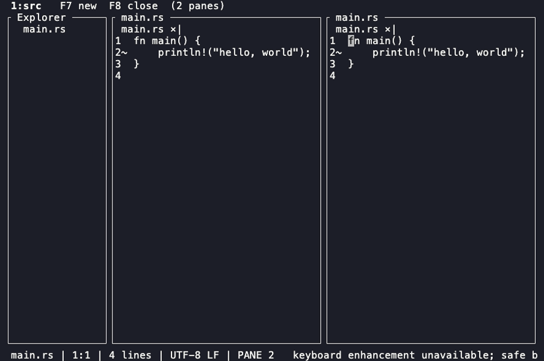

# i3-editor

A keyboard-first terminal text editor written in Rust: file explorer, document
tabs, panes, and workspaces, all inside the terminal.

Built with Ratatui + Crossterm, with a Ropey text buffer and a grapheme-aware
cursor. Configuration lives in TOML.

[](https://github.com/afi3/i3-editor/actions/workflows/ci.yml)



## Install

macOS (Intel and Apple Silicon) and Linux (x86_64 and aarch64):

```bash
curl -fsSL https://raw.githubusercontent.com/afi3/i3-editor/main/install.sh | sh
```

The installer downloads the release asset for your platform, verifies its
SHA-256 checksum, and puts `i3-editor` in `~/.local/bin` (add that to `PATH` if the
script asks). Options:

```bash
# custom location
curl -fsSL https://raw.githubusercontent.com/afi3/i3-editor/main/install.sh \
  | sh -s -- --prefix "$HOME/bin"

# pinned version
curl -fsSL https://raw.githubusercontent.com/afi3/i3-editor/main/install.sh \
  | sh -s -- --version 0.2.0

# update an existing install (installer or the binary itself)
i3-editor --update
curl -fsSL https://raw.githubusercontent.com/afi3/i3-editor/main/install.sh \
  | sh -s -- --update

# remove the binary (settings and themes are kept)
curl -fsSL https://raw.githubusercontent.com/afi3/i3-editor/main/install.sh \
  | sh -s -- --uninstall
```

`--update` asks the GitHub API for the latest release and compares it with
`i3-editor --version`; combine the installer form with `--version` to pin.
`--uninstall` removes only the binary and reports the configuration directory,
which stays on disk unless you delete it.

### Self-update

`i3-editor --update` performs the same update without the installer. Releases
before 0.1.1 predate the flag, so update those once with the installer form above:

1. Reads `https://api.github.com/repos/afi3/i3-editor/releases/latest`.
2. Exits with `already up to date` when the running version is current, and does
   not downgrade when the running build is newer.
3. Downloads `i3-editor-<target>.tar.gz` and its `.sha256` from the release,
   verifies the checksum, and extracts the binary.
4. Replaces the canonical executable through a sibling temporary file and a
   rename, so a failed update never truncates the running binary.

It needs `curl` and `tar` (both present on macOS and Linux by default), write
permission to the binary's directory, and network access. Configuration, themes,
and the session file are untouched. If permission is denied, rerun with `sudo`
or use the installer with `--prefix`. The checksum comes from the same release,
so it protects against transfer corruption but not a compromised repository;
there is no signature. For mirrors or local testing, `I3_EDITOR_UPDATE_API`
(full API URL) and `I3_EDITOR_UPDATE_BASE` (release download base, the tag is
appended) override the endpoints.

`--help` prints all options; `I3_EDITOR_INSTALL_DIR` and `I3_EDITOR_VERSION` work
too. If no matching release asset exists yet, the script falls back to
`cargo install --git https://github.com/afi3/i3-editor --locked`, which needs a
Rust toolchain from <https://rustup.rs>.

Release binaries are produced by `.github/workflows/release.yml` when a `v*` tag
is pushed. Without Cargo and without a release, install Rust first or build from
source as shown below.

## Build and run

```bash
cargo build --release
cargo run                      # open the current directory
cargo run -- .                 # same, explicit
cargo run -- src/main.rs       # open a file directly
cargo run -- src/main.rs:42    # open one file at a 1-based line
cargo run -- a.rs b.rs         # open multiple files as tabs
cargo run -- --update          # self-update from the latest release
cargo run -- --dump-keymap     # probe and print the resolved bindings
cargo run -- --version         # print the version
cargo run -- --help            # usage summary
```

Multiple file arguments open as document tabs. `FILE:LINE` accepts one file; a
directory must be the only target. Unknown options are errors, and `--update` or
`--dump-keymap` cannot be combined with paths.

Stable Rust 1.91+ (edition 2024). The editor needs no system dependencies beyond
a POSIX terminal; `--update` additionally uses `curl` and `tar`.

## Interface

```text
 workspace tabs (F7 new, F8 close)
+------------------------------------------------+
| Explorer   | pane 1        | pane 2  | AI     |
|            | tabs / text   |         | chat   |
+------------------------------------------------+
 status bar: file | line:col | lines | UTF-8 EOL | focus | message
```

- Explorer: 20% of the width by default, collapsible with `Ctrl+B`.
- Panes: recursive weighted splits, independent cursor, selection, and scroll.
- Workspaces: independent layouts and tabs; switching preserves everything.
- AI panel: optional right-side transcript and input; `ai_chat` opens it and
  `ai_panel` toggles it.

## Default keys

Terminals cannot represent every modifier combination, so the defaults avoid
the undecidable ones: no `Ctrl+Shift+<letter>`, no `Ctrl+H` (it is Backspace),
no `Alt+<letter>`, no `Ctrl+2`..`Ctrl+8`.

Startup probes keyboard enhancement support. Without it the `safe` preset is
forced and the status bar names the actions whose default binding needs
enhancement (`switch_workspace`); `next_workspace` / `prev_workspace` in the
palette keep every workspace reachable. `Ctrl+C`
closes an active prompt; with no selection it reports `nothing to copy`.
Bracketed paste is routed by owner: a prompt field while a prompt is open, the
PTY while the terminal panel has focus, and the active document otherwise. The
prompt overlay also captures mouse input, so clicks cannot move the cursor behind
it.

| Key | Action |
|---|---|
| `Ctrl+Q` | Quit |
| `Ctrl+S` | Save |
| `F2` | Save As |
| `Ctrl+O` | Open a path |
| `Ctrl+P` | Quick open |
| `Ctrl+N` | New file (asks for a path, creates it) |
| `Ctrl+W` | Close document (prompts when dirty) |
| `Ctrl+B` | Toggle explorer / focus explorer |
| `F1` | Command palette |
| `Ctrl+G` | Go to line |
| `Ctrl+Tab` / `BackTab` | Next / previous document |
| `F3` / `F4` | Split left-right / top-bottom |
| `F5` | New terminal tab |
| `F11` | Close the active terminal tab |
| `F6` | Close pane |
| `Ctrl+Shift+Arrow` | Move focus between panes |
| `F9` | Toggle fullscreen for the focused pane |
| `F10` | Grab mode: arrows move the focused pane (Esc exits) |
| `F12` | Toggle tabbed container for the focused split |
| `Ctrl+PageUp` / `Ctrl+PageDown` | Previous / next container tab, or terminal tab while the shell has focus |
| `F7` / `F8` | New / close workspace |
| `Ctrl+1`..`Ctrl+9` | Switch workspace (best effort) |
| `Ctrl+Z` / `Ctrl+Y` | Undo / redo |
| `Shift+Arrow`, `Shift+Home/End` | Extend selection |
| `Ctrl+A` | Select all |
| `Ctrl+C` / `Ctrl+X` / `Ctrl+V` | Copy / cut / paste |
| `Ctrl+F` / `Ctrl+R` | Find / replace all |
| `Ctrl+D` | Duplicate line |
| `Ctrl+Space` | LSP completion |
| `Ctrl+K` | LSP hover |
| `Tab` | Indent: spaces to the next stop, or a literal tab |

Explorer focus keys: `Up`/`Down`, `Enter` (open), `Right`/`Left` (expand or
collapse), `n` new file, `Shift+N` new directory, `r` rename, `d` delete,
`h` hidden and ignored files (such as `.env`), `Ctrl+R` refresh.

Mouse: click a pane to focus it, drag a pane border to resize the split.

- Editor: click places the cursor at that cell (tabs and wide characters are
  measured in display cells); `Shift`+click extends the selection; the wheel
  scrolls three lines without moving the cursor; `ScrollLeft`/`ScrollRight`
  (horizontal wheel or `Shift`+wheel) scrolls four columns. Files taller than the
  pane get a right-edge vertical scrollbar: click the track to jump, or drag the
  thumb to move through thousands of lines quickly. `PageUp`/`PageDown` move by
  a page and `Ctrl+Home`/`Ctrl+End` jump to the document edges.
- Explorer: click selects a row, double-click opens the file (or toggles a
  directory), wheel moves the selection three rows at a time.
- Document tabs: click a tab to focus its pane and activate that file; click the
  `×` on a tab to close that file (a dirty file still asks before discarding).
  When the strip overflows, `‹` / `›` step one tab and the wheel scrolls the
  strip; the active tab stays in view until you scroll manually.
- Container tab strip: click a tab to activate it.

### Help overlay

`help` from the palette opens a read-only list built from the active keymap:
global, editing, explorer, and palette-only commands with their descriptions.
`Up`/`Down`, `PageUp`/`PageDown`, and `Home`/`End` scroll; `Esc` or `q` closes.
The list reflects `config.toml` overrides and the safe preset.

### Quick open and command palette

`Ctrl+P` lists project files and `F1` lists commands; `Ctrl+O` takes a typed
path. The two lists match fuzzy, scored by [Nucleo](https://github.com/helix-editor/nucleo): the query is a
subsequence of the candidate, with bonuses at path separators, underscores, and
word boundaries, and smart case (an uppercase letter in the query makes matching
case-sensitive). The file list is scanned once and kept current by the
filesystem watcher; quick open no longer walks the project on every invocation.

| Query | Result |
|---|---|
| `sm` | `src/main.rs`, ranked above `docs/domain_main.md` |
| `trm` | `terminal` |
| `SM` | only candidates containing uppercase `S` then `M` |

Enter opens the selected candidate. While typing, the best-ranked candidate is
selected, so Enter acts on what the list shows. After `Up` / `Down`, the chosen
candidate is kept across further keystrokes; it falls back to the best match once
it no longer matches the query. Palette rows show the command description and the
binding that currently wins on the focused surface; unbound commands have no
hint and remain palette-only.

### Find and replace

`Ctrl+F` opens Find and searches as you type: every match is highlighted in the
document, the prompt lists matching lines with their line numbers (`Find 2/57` in
the title), and the cursor jumps to the selected match.

- `Up` / `Down` step through the list and wrap at both ends.
- `Enter` keeps the selected match, closes the prompt, and leaves the search
  active; `next_match` from the palette (`F1`) continues from there.
- The list shows up to eight rows around the selection; the buffer may hold more.
- `Ctrl+R` replaces every occurrence of the first field with the second.
- `Alt+R` toggles regex mode, `Alt+W` whole word, `Alt+C` case sensitivity. The
  title shows the active flags (`.*`, `W`, `Aa`), and the same options apply to
  Find, Replace, Find in Files, and Replace in Files. Literal queries ignore
  case until `Alt+C`; regex replacements expand `$1` groups.
- `Alt+Up` / `Alt+Down` cycle the last 50 submitted queries for the current
  surface. Queries and search options persist in
  `<config>/i3-editor/history.toml`.

### Find in files

Find in Files searches every project file listed by quick open and streams the
matches into the prompt as they arrive. There is no default key because terminals
cannot distinguish `Ctrl+Shift+F`; run `find_in_files` from the command palette
(`F1`), or bind it in `config.toml` if your terminal reports the combination:

```toml
[keys.editing]
"ctrl+shift+f" = "find_in_files"
```

- Matching uses the shared search options above: literal or regex, whole word,
  and case-insensitive unless `Alt+C` is on.
- Results show `path:line:column` plus a preview window capped to about 160
  characters around the match. Long lines do not inflate memory; the column is a
  char offset. `Up` / `Down` choose a result; `Enter` opens that file and puts
  the cursor on the match; `Esc` cancels the scan and closes the prompt.
- Typing restarts the scan. The previous worker is cancelled, so only the newest
  query can publish results.
- The scan searches files on disk, not unsaved buffer contents, skips files above
  1 MiB and files that are not UTF-8, and stops at 1000 matches (the title shows
  the count with a `+`).
- Files hidden by `.gitignore` are excluded unless the explorer's hidden toggle
  is on, matching quick open.

### Replace in files

`replace_in_files` from the palette (`F1`) opens the same scan with a second
field. Nothing is written while the preview streams:

- `Tab` moves from the query to the replacement. `Enter` on the query moves to
  the replacement; `Enter` there is the per-file confirmation and writes only the
  selected file. `Ctrl+Enter` performs the same confirmation from either field.
- The title counts matches and files, with `+` when the scan was truncated.
- Clean open buffers are rewritten through their undo history and saved
  atomically, so `Ctrl+Z` restores the pre-replace text. Dirty buffers are
  skipped with a message; save them first.
- Files that are not open are read, replaced, and written atomically. The scan
  refreshes after each write and the prompt stays open for the next file; `Esc`
  cancels.

### Symbols and folding

Both commands are in the palette (`F1`); neither has a default key because
terminals disagree about `Ctrl+Shift` combinations.

- `go_to_symbol` lists the definitions tree-sitter finds in the active document
  (Rust, Python, JavaScript/TypeScript, Go, C, Shell, Lua, Markdown headings,
  TOML tables). Typing filters the list; `Enter` jumps to the definition and
  opens any fold covering it.
- `fold` folds the smallest block starting at the cursor line: functions,
  classes, `impl`/`mod`, match and block expressions, Markdown sections and
  fenced code, and TOML tables. The header line stays visible and the rest of the
  range disappears from the viewport; fold headers keep their original line
  numbers.
- A second `fold` on the header opens it. Any edit unfolds the document,
  because tree-sitter line ranges move under edits.

### File operations

These commands are palette-only (`F1`); bind them under `[keys.explorer]` or
`[keys.global]` if your terminal can emit the combination.

- `duplicate_file` copies the target file beside itself as `name copy.ext`, then
  `name copy 2.ext`, and so on. Only files inside the workspace root are
  duplicated; a dirty buffer is refused with a status message, so save it first.
- `copy_path` puts the absolute target path in the internal clipboard and asks
  the terminal to place it in the system clipboard with OSC 52.
- `reveal_in_terminal` opens a new terminal tab in the target directory, or in
  the parent directory when the target is a file.

When the explorer has focus its selected row is the target. Otherwise the active
document is, falling back to the explorer selection. Directories can be copied or
revealed; only regular files can be duplicated.

### Workspace roots

Each workspace watches its root, the expanded explorer directories, and the
parent directories of its open documents without recursion:

- `workspace_root` from the palette prompts for a directory and rebuilds the
  explorer, quick-open list, and watcher for the active workspace. A new
  workspace (`F7`) inherits the active root.
- Switching workspaces (`Ctrl+1`..`Ctrl+9`, `F7`/`F8`, or the palette) swaps the
  explorer to that workspace's root and clears the quick-open cache; the tree is
  rebuilt for the new root.
- Workspace watchers are non-recursive. File events from an inactive workspace
  still reload open buffers but do not rebuild the active explorer tree.
  Unexpanded directories are watched after the explorer opens them.
- Open documents outside every workspace root get a non-recursive watcher on
  their parent directory, so external saves still reload clean buffers and warn
  on dirty ones.
- `rename_workspace` from the palette prompts for a new workspace-tab name.
- `workspace_terminal_dir` sets where new terminal tabs for the active workspace
  start; the directory is stored in `session.toml`. Changing the workspace root
  updates it only while it still equals the old root.
- `session.toml` stores each workspace root, so a restored session keeps the
  independent environments.

### Crash recovery

- Dirty buffers with a path are written at most once per second to
  `<config>/i3-editor/swap/`, using an unpredictable temporary file and an
  atomic rename. Untitled buffers and files above 16 MiB are skipped.
- On the next start each swap reopens the file as a tab and asks once per file:
  **Save recovered buffer** (overwrite the file), **Reload from disk** (drop the
  recovered text), or **Keep unsaved buffer**. `Esc` keeps the buffer.
- A saved or discarded buffer drops its swap on the next pass. A graceful exit
  deletes the swap directory, so choosing "discard all and quit" cannot resurrect
  the discarded text on the next start.

### Language servers (LSP)

The editor speaks a minimal subset of LSP over stdio: full document sync,
diagnostics, completion, hover, and go-to-definition. Servers start lazily when a
matching document opens; a missing or crashing server never blocks editing.

- **Install from the palette:** open a file, press `F1`, and choose
  `lsp_install`. The active file selects the provider, so `.rs` installs Rust,
  `.py` installs Python, and so on. Installation runs in the background and
  reports progress in the status bar.
- Built-in providers: Rust (`rust-analyzer`), Python (`pylsp`), JavaScript /
  TypeScript, Lua, YAML, and Dockerfile/Containerfile. A server already on
  `PATH` is reused; otherwise Rust uses `rustup`, Python uses an isolated
  virtualenv + `pip`, JavaScript/TypeScript/YAML/Dockerfile use `npm`, and Lua
  downloads a pinned, checksum-verified GitHub release.
- Local servers live under `<config>/i3-editor/lsp/`. The installer writes
  `<config>/i3-editor/lsp.toml`; an explicit `[lsp.<name>]` in `config.toml`
  always wins. `lsp_uninstall` removes only the managed entry and keeps local
  binaries for reuse or manual deletion. To update, uninstall and install again.
- npm and pip package versions are pinned; a server already on `PATH` is never
  modified. Dockerfile matching accepts `Dockerfile`, `Containerfile`,
  `Dockerfile.*`, `Containerfile.*`, `*.Dockerfile`, and `*.Containerfile`.
- Requirements when a system server is absent: `rustup` for Rust, Python 3 +
  `pip` for Python, and Node.js + `npm` for JavaScript/TypeScript, YAML, and
  Dockerfile. The installer reports the missing tool instead of running a
  partial install.
- Configure one table per server manually when using a custom binary. The table
  name is the default language match; `extensions`/`filenames` override it:

```toml
[lsp.rust]
command = "rust-analyzer"
args = []

[lsp.python]
command = "pylsp"
extensions = ["py", "pyi"]

[lsp.dockerfile]
command = "docker-langserver"
args = ["--stdio"]
filenames = ["Dockerfile", "Containerfile", "Dockerfile.*", "*.Dockerfile"]
```

- Diagnostics appear as `•` markers in the gutter (red error, yellow warning,
  cyan info) and as `LSP nE mW` in the status bar for the active document.
- `lsp_completion` (`Ctrl+Space`) opens a popup above the status bar. `Up` /
  `Down` choose an item, `Enter` inserts its text, and `Esc` or any other key
  closes the popup without eating that key.
- `lsp_hover` (`Ctrl+K`) shows the server's hover text in a bordered popup; any
  key closes it.
- `lsp_definition` (palette-only) opens the target file, unfolds the line, and
  puts the cursor on the definition. Bind a key if your terminal can emit it.
- Sync is full-text on every change; positions convert between char offsets and
  LSP's UTF-16 columns. Server failures and protocol errors surface through the
  status bar once per server.
- Changing the workspace root or any `[lsp.*]` table restarts every configured
  server against the new root/config; open documents are reopened. Requests that
  never answer are dropped: 60 s for `initialize`, 15 s for
  completion/hover/definition. A timed-out `initialize` marks that server failed
  for the current root/config.

`Ctrl+Space` and `Ctrl+K` are the default completion and hover bindings; both
can be overridden. `lsp_definition` has no default key; bind it under
`[keys.editing]` if the terminal can emit the combination, for example
`"ctrl+u" = "lsp_definition"`.

### MCP servers

MCP support is a stdio JSON-RPC client. It does not auto-start servers and never
applies a tool result to a buffer.

```toml
[mcp.filesystem]
command = "npx"
args = ["-y", "@modelcontextprotocol/server-filesystem", "/home/arif/project"]
cwd = "/home/arif/project"
env = { TOKEN = "..." }
```

- `F1` → `mcp_add` starts the wizard. Choose `filesystem`, enter a directory
  (prefilled with the workspace root), or choose `everything` for a protocol
  demo; the wizard writes `<config>/i3-editor/mcp.toml`.
- `F1` → `mcp` opens the server menu. The first start shows a trust prompt with
  the command to run; changing command, args, cwd, or env changes the trust
  hash and prompts again. Trusted hashes persist in
  `<config>/i3-editor/mcp_trust.toml`.
- After trust, the server starts lazily and `tools/list` populates the tool menu.
- Selecting a tool opens a form generated from its JSON schema: strings,
  integers/numbers, booleans, enums, and a JSON fallback for nested values.
  `path` fields are prefilled from the active file or workspace root. `Tab`
  moves between fields; `Enter` opens a per-call confirmation. Cancelling trust
  never spawns the server; cancelling a call sends no request. Recent tools are
  sorted first and persisted in `mcp_recent.toml`. The tool list also has a
  `logs` row for the server's stderr ring.
- A tool result opens in a read-only overlay. It cannot edit a buffer or run a
  shell command automatically. `Esc` or `q` closes the overlay.
- Only stdio transport is supported. HTTP/SSE, resources, prompts, and automatic
  tool loops are deferred.

Manual real-server check:

```bash
cargo test real_filesystem_mcp_server -- --ignored
```

It requires Node/npm and downloads `@modelcontextprotocol/server-filesystem`;
CI uses the local mock server instead.

### AI assistant

The assistant is an OpenAI-compatible chat panel with a bounded MCP tool loop.
It does not stream, send project context automatically, or edit buffers.

```toml
[ai]
base_url = "https://openrouter.ai/api/v1"
model = "openai/gpt-4o-mini"
api_key_env = "OPENROUTER_API_KEY"
api_key = ""                     # optional local override; prefer the env var
timeout_secs = 60
max_context_tokens = 16000       # prompt budget; old turns are dropped
max_tool_output_chars = 20000    # one MCP result kept in history
max_history_turns = 24
allowed_tools = []               # empty = every trusted tool; supports server/*
denied_tools = ["filesystem/write_file"]
retry_attempts = 2               # additional attempts for 429/5xx/transient curl
retry_base_ms = 500              # exponential backoff base
retry_max_ms = 8000
panel_width = 20                 # percent of terminal width
```

- `F1` → `ai_chat` opens and focuses the right-side `AI` panel; `ai_panel`
  toggles it. `ai_wider`/`ai_narrower` resize it, `ai_clear` clears a finished
  conversation, and `ai_copy` copies the transcript to the internal and system
  clipboards. The panel keeps session-only history.
- Type a message and press `Enter`. If trusted MCP servers are still reading
  their tool lists, the question waits and is sent once the tools are loaded.
  The active turn shows `thinking...` until the reply arrives. `Esc` cancels a
  running request or tool call; cancelling a tool call terminates that MCP
  server process, and its tools are reloaded on the next question. `Esc` with
  no active turn leaves the panel focused state. Retryable HTTP failures
  (408/425/429/5xx) and transient curl failures use bounded exponential
  backoff; `Esc` also interrupts the backoff.
- Configured MCP tools are sent with the request. When the model asks for one,
  the panel shows the server, tool, and JSON arguments and asks for
  confirmation: `y`/`Enter` runs it, `n`/`Esc` denies it. Trust must already be
  granted in the `mcp` menu; the harness cannot bypass the trust gate.
- Tool results are appended to the transcript as untrusted text and returned to
  the model. A turn stops after 8 model round trips, on cancellation, or on an
  API/MCP error. There is no automatic edit, patch apply, or background agent.
- Before each request the conversation is capped by `max_context_tokens` and
  `max_history_turns`; old turns are dropped and oversized tool text is
  truncated. One MCP result is capped by `max_tool_output_chars` before it
  enters the conversation.
- `allowed_tools` and `denied_tools` accept exact `server/tool` names or a
  trailing/leading `*` (for example `filesystem/*`). Blocked tools are not sent
  to the model; an unexpected call is rejected and recorded. Tool annotations
  classify confirmation text as `read-only`, `write`, or `destructive`.
- Every tool decision and result is appended to
  `<config>/i3-editor/audit.jsonl`. Arguments are truncated and keys containing
  token, secret, password, authorization, or api_key are redacted.
- The panel title shows estimated conversation tokens against the configured
  budget. Headings, fenced code, and user turns get basic Markdown styling;
  long transcript lines wrap inside the panel, and `Ctrl+Left`/`Ctrl+Right`
  scrolls horizontally when needed.
- The default provider is OpenRouter (`https://openrouter.ai/api/v1`,
  `openai/gpt-4o-mini`) with `OPENROUTER_API_KEY`. Put the key in the
  environment for normal use; `api_key` is available only as an explicit local
  config override and is not written by the editor.

### Native hashline tools

The harness also exposes two built-in tools, independent of MCP:

- `native/read_file {"path": "...", "start_line": 1, "end_line": 400}` returns
  `path`, `total_lines`, a file `snapshot`, and lines shaped like
  `42:a3f1c9|    let value = 1;`.
- `native/search {"query": "regex", "glob": "src/**/*.rs"}` walks the workspace
  with `ignore` (honoring `.gitignore`) and returns matching files with their
  snapshot and hashed lines. It supports `show_hidden`, `case_sensitive`, and
  `max_results`; no external `grep` process is started.
- `native/edit_file` takes `path`, the `snapshot`, and an `edits` array of
  `{line, hash, text}`. Every line hash and the snapshot are validated before
  one atomic write; edits apply from bottom to top. Empty `text` deletes the
  line.
- Reads and edits are limited to regular UTF-8 files inside the workspace root,
  at most 16 MiB. Symlinks escaping the root, stale hashes, stale snapshots,
  and dirty open buffers are rejected. A clean open buffer is reloaded after a
  successful edit.
- The tools use the same `allowed_tools`/`denied_tools` policy, confirmation,
  capability labels (`read-only`/`destructive`), and audit log as MCP tools.
  `native/read_file`, `native/search`, and `native/edit_file` are visible even
  when no MCP server is configured.

Post-edit `cargo check` verification is not part of this slice.
- The API key is read from `api_key_env`; leave it empty for a local
  OpenAI-compatible server without authentication.
- Requests are non-streaming and do not include the active file unless you paste
  it into the prompt. Context indexing and automatic edits are not part of this
  slice.

### Git

Git runs through the configured binary (`[git] binary`, default `git`); there is
no library dependency. The active workspace root must be inside a work tree.

- The gutter marks changed lines against `HEAD`: `+` added (green), `~` modified
  (yellow), `-` deleted (red). Markers refresh after open/save, after Git
  commands, and at most once per second.
- `git_status` opens a prompt listing `XY path` porcelain codes. Filtering works
  normally; `Enter` opens a read-only diff for that file.
- `git_diff` shows the active file's unstaged diff (falling back to the staged
  diff when the worktree is clean). The overlay scrolls with `Up`/`Down`,
  `PageUp`/`PageDown`, `Home`/`End`; `Esc` or `q` closes it. It never writes.
- `git_log` opens the same read-only overlay with the current branch, local
  branches, and the latest 50 commits (`hash  date  author  subject`). It works
  even before the first commit, reporting `unborn` and `(no commits yet)`.
- `git_stage` and `git_unstage` act on the active file. `git_commit` prompts for
  a message and commits the staged index.
- `git_stage_hunk` and `git_unstage_hunk` open a hunk picker for the active file:
  `Up`/`Down` selects a hunk, `PageUp`/`PageDown` scrolls its body, `Enter`
  applies the selected hunk to the index (or removes it with `--reverse`), and
  `Esc`/`q` closes. An untracked file has no applicable hunk context, so staging
  a hunk stages the whole file.
- `git_pull` fast-forwards the current branch from its upstream. It refuses a
  dirty index/worktree or any unsaved editor buffer before running, and uses
  `--ff-only` so it never creates a merge or conflict state.
- `git_push` pushes the current branch to its configured upstream. Terminal
  credential prompts stay disabled; SSH agents and credential helpers work. A
  missing upstream or rejected push is reported in the status bar.
- `git_conflicts` lists conflicted files from the porcelain status. `Enter` opens
  the file (reloading a clean stale buffer), jumps to the first `<<<<<<<` marker,
  and reports the line in the status bar.
- `resolve_conflict_ours`, `resolve_conflict_theirs`, and `resolve_conflict_both`
  replace the conflict block at or after the cursor as one undo step. After the
  last block is gone the status bar asks you to stage the file.
- Every failure (not a repository, nothing staged, git missing) is reported in
  the status bar.

These commands are palette-only; bind them under `[keys.editing]` if wanted.

### Multi-cursor, wrapping, and line endings

- `add_cursor_below` / `add_cursor_above` (palette) add secondary cursors at the
  same column on the next/previous line. `clear_cursors` removes them.
- Every caret is drawn: the primary caret is the terminal cursor, and each
  secondary caret is a reverse-video block. Secondary selections use the normal
  selection color.
- Typing, `Enter`, `Tab`, `Backspace`, `Delete`, paste, `Copy`, and `Cut` apply
  to every cursor. Each multi-cursor edit is one undo step, and undoing it drops
  the secondary cursors back to the primary.
- Alt-drag inside a pane is a rectangular (column) selection: every line in the
  dragged range gets a selection between the anchor column and the release
  column. Copy joins the selections with newlines; Cut removes them as one step.
- `word_wrap` (palette) or `[editor] word_wrap = true` enables soft wrap.
  Wrapped rows break at spaces when possible; long words break at the width.
  `Up`/`Down` move by visual row, clicking maps to the clicked visual row, and
  the cursor/selection/gutter all follow the same mapping. Horizontal scrolling
  is disabled while wrapped.
- `line_endings_lf` and `line_endings_crlf` (palette) convert the whole document
  as one undo step. The status bar shows the new `LF`/`CRLF`, new lines use that
  ending, and the next save writes exactly those bytes. Mixed endings are
  normalized by the conversion only; a normal save never rewrites them.
- Non-UTF-8 files are still refused when opened, with a status-bar message.

### Lua plugins

Every `*.lua` file in `<config>/i3-editor/plugins/` is loaded at startup and
reloaded when the directory changes. The API is versioned (`api_version == 1`):

```lua
commands.register("my_command", function()
  fs.write_file("/tmp/ran", "yes")       -- only with [lua] allow_file = true
end)

keymap.set("ctrl+alt+m", "my_command")   -- palette remains the fallback

events.on("save", function()             -- open | save | change | focus
  marker = editor.path()
end)

statusline.register(function()
  local selections = editor.selections()
  return editor.language() .. ":" .. #selections
end)
```

- `editor.path()`, `editor.language()`, `editor.cursor()` (returns 0-based line
  and char column), and `editor.selections()` (always a list of
  `{start, end}` char ranges, including carets).
- Plugin commands appear in the command palette; `keymap.set` adds a binding
  without touching `config.toml`.
- Callbacks run on the UI thread with an instruction budget (`[lua]
  time_budget_ms`, 10–5000 ms). A callback that exceeds it is aborted and
  reported. Re-entrancy is limited to four nested callbacks.
- Sandbox default: no `io`, `os`, or `package`. `[lua] allow_file = true` loads
  `io` and exposes `fs.write_file(path, contents)`; `allow_process = true` loads
  `os` and exposes `process.run(program, [args])`. Both are explicit opt-ins.
- Errors include the plugin file and line, are stored in `messages`, and a
  plugin is disabled after three failures. Reloading unregisters that plugin's
  commands, keymaps, events, and statusline segments before loading again.
- `statusline` strings render after the LSP counts in the status bar.
- TOML remains the validated source of truth for settings; an `init.lua` overlay
  is not supported.

Demo plugins live in `plugins/` in this repository; copy them into the config
directory to try the API.

### Open two files side by side

1. Open the first file (`Ctrl+O` for a path, or `Ctrl+P` to fuzzy-find).
2. `F3` (left/right) or `F4` (top/bottom) splits the focused pane; the new pane
   inherits the same file.
3. Open the second file while that pane is the last one edited — click it, or
   press `Ctrl+B` and pick the file in the explorer. It opens in the remembered
   pane, not in the first pane.
4. `F10` then an arrow swaps the focused pane with its neighbour; `Esc` leaves
   grab mode.

Each pane keeps its own tabs, cursor, selection, and scroll, even when they show
the same buffer.

### Tabbed container (i3 `layout tabbed`)

`F12` converts the innermost split around the focused pane into a tabbed
container: siblings stop tiling, the container keeps a one-row tab strip, and
only the active tab is laid out. `F12` again returns to tiled layout with the
split weights intact.

- `Ctrl+PageDown` / `Ctrl+PageUp` cycle tabs; clicking a tab does the same.
- Splitting inside a tabbed container opens the new pane as a new tab.
- Closing the last tab of a container collapses it into the remaining child.
- `F9` fullscreen hides the strip; `F10` grab mode still swaps the pane.
- Tabs are per container, so nested tabbed containers each get their own strip.

## Themes and syntax colors

`appearance.theme` names either a built-in preset or a file in
`$XDG_CONFIG_HOME/i3-editor/themes/` (default `~/.config/i3-editor/themes/`).
A theme file wins over a preset with the same name, so `dark.toml` overrides the
`dark` preset. Unknown names fall back to `default` and report the available
names in the status bar.

| Preset | Look |
|---|---|
| `default` | Terminal colors; no background override, blue selection |
| `dark` | Dark background, muted gutter, cyan accent, VS Code-like tokens |
| `light` | Light background, dark text, classic light token colors |
| `high-contrast` | Black on white with yellow cursor line, border, and selection |

### Theme files

Drop `<name>.toml` in the themes directory and set `appearance.theme = "<name>"`.
Every key is optional; `base` inherits from a preset, so a file can override just
a few colors. Unknown keys are reported instead of being ignored.

```toml
# ~/.config/i3-editor/themes/mine.toml
base = "dark"                 # preset to inherit from (default: "default")

background = "#101014"
foreground = "#e6e6e6"
current_line = "#18181f"
selection = "#2b4b8f"
selection_text = "#ffffff"
gutter = "#5a5a66"
gutter_active = "#e6e6e6"
border_active = "#7aa2f7"
border_inactive = "#2a2a33"
tab_active = "#1c1c24"
tab_inactive = "#5a5a66"
status_bar = "#1c1c24"
status_text = "#e6e6e6"
explorer_dir = "#7aa2f7"
prompt_border = "#7aa2f7"

[syntax]
keyword = "#c678dd"
string = "#98c379"
comment = "#5c6370"
number = "#d19a66"
function = "#61afef"
type_name = "#e5c07b"
constant = "#56b6c2"
operator = "#abb2bf"
punctuation = "#8b93a1"
```

Colors accept `#rgb`, `#rrggbb`, `indexed:0..255`, or names such as `reset`,
`black`, `red`, `…`, `white`, `gray`, `darkgray`.

### Syntax highlighting

Rust, Python, JavaScript/TypeScript, Go, C, Shell, TOML, JSON, and Markdown are
highlighted from tree-sitter parse trees. The grammar's highlight query decides
the token kind, so Rust raw strings, shell heredocs, nested block comments, and
template literals keep their color across line breaks, and identifiers are
classified by their role in the tree rather than by naming convention. Each
document keeps its tree and hands every edit to it as an `InputEdit`; the next
frame reparses only the changed region and runs the query over the visible lines
instead of the whole file.

Markdown uses five grammars: the block grammar highlights headings, fences, and
links; visible inline content is parsed with the inline grammar for emphasis,
links, and code spans; HTML blocks plus inline tags use the HTML grammar; YAML
front matter (`--- ... ---`) uses the YAML grammar and TOML front matter
(`+++ ... +++`) the existing TOML grammar. Each fenced block is
parsed with the language named in its info string, so Rust, Python, Shell, TOML,
JSON, and the other supported languages are highlighted structurally inside the
fence. These secondary trees are cached by byte offset and dropped on edit.

Files with other extensions render in the theme foreground.

Known limit: an unknown fence language stays plain text.

The terminal backend honors `NO_COLOR`: when that variable is set, color
sequences are suppressed and the theme has no visible effect. `--dump-keymap`
prints the resolved theme name and keyboard-enhancement probe, which is the
quickest way to confirm a config and theme file were read.

### Saving and quitting

- `Ctrl+Q` always confirms first. Clean sessions offer `Quit` / `Cancel`;
  modified documents offer `Save all and quit` / `Discard all and quit` /
  `Cancel`. Arrow keys choose, `Enter` confirms, `Esc` cancels.
- `Ctrl+W` on a modified document asks before discarding.
- `F6` is refused while the pane still holds modified documents; save or close
  them first, so no document becomes unreachable.
- Undo keeps the last 1000 batches. Undoing back to the saved revision clears the
  modified marker, and redo restores it.
- A save writes a sibling temporary file, flushes it, and renames it over the
  target: a crash or full disk during the write cannot truncate the original.
  Existing permissions are preserved and symlinks are resolved, so the link stays.
- `new_scratch` from the palette opens an empty untitled buffer. `Ctrl+S` or
  `F2` saves it through Save As; scratch buffers are not written to
  `session.toml` or crash recovery.
- `F2` Save As asks for confirmation before replacing a different existing file.
- The workspace root, expanded explorer directories, and parent directories of
  open documents are watched without recursion. A clean buffer reloads when
  another program writes its file; a modified buffer is left alone and the status
  bar reports the change, so `Ctrl+S` still asks before anything is written.
  Explorer rows refresh on create, rename, and delete without pressing refresh.
- If another program changed the file since it was loaded, `Ctrl+S` asks first:
  `Overwrite with the buffer` or `Reload from disk`. Nothing is written until you
  choose, so an external edit is never clobbered silently.

### Sessions

On exit and at most once every five seconds while running, the editor writes
`<config>/i3-editor/session.toml`: workspaces, layout trees, pane tabs (saved
files only), cursor, and scroll. Launching without a path argument in the same
directory restores it; launching with a path starts fresh. Untitled buffers are
not persisted, files that no longer exist are skipped with a status-bar warning,
and closing every document removes the session file. The session is validated
(version, counts, layout invariants) before it can replace the default
workspace; a broken session is reported and ignored.

## Terminal panel

The editor can host real shells in a panel at the bottom of the window, outside
the panes. Open it from the command palette (`F1`, then `terminal`); the
same command closes the panel and kills every shell in it.

- `F5` (or `new_terminal`) adds a shell tab and focuses it; `F11` (or
  `close_terminal`) closes the active tab and closes the panel with the last one.
  `Ctrl+PageUp` / `Ctrl+PageDown` cycle tabs while the panel has focus; the title
  marks the active one as `[2* /bin/zsh]`.
- `rename_terminal` (palette) renames the active tab for the current run.
- The shell comes from `[terminal] shell`, otherwise `$SHELL`, otherwise
  `/bin/sh`; new tabs start in the active workspace's terminal directory
  (`workspace_terminal_dir`, default: the explorer root), except a tab opened by
  `reveal_in_terminal`, which starts in the revealed directory.
- While the panel has focus, every key is forwarded to the shell except `Ctrl+Q`,
  `F1`, the terminal toggle, and the terminal-tab commands. Modified arrows,
  Home/End, Insert/Delete, PageUp/PageDown, and F1–F12 use xterm CSI modifier
  sequences; `Ctrl+[`, `Ctrl+\`, `Ctrl+]`, `Ctrl+^`, and `Ctrl+_` are forwarded.
- Scrollback is clamped to `[terminal] scrollback`, not a fixed 2000 lines.
  Dropping a shell kills and reaps its child process.
- Click the panel to focus it. When the program in the shell enables mouse
  reporting (`DECSET 1000`, `1002`, or `1003`), clicks, drags, and wheel events
  inside the panel are sent to it using the encoding it asked for (SGR, UTF-8,
  or X10); the protocol mode gates presses, releases, and motion. Otherwise the
  wheel scrolls `[terminal] scrollback` lines (default 2000).
- The panel height comes from `[terminal] height`; panes keep their minimum size,
  so the panel shrinks instead of squeezing them out.
- Output is parsed with `vt100` (colors, bold, underline, inverse, cursor) and
  rendered with the active theme's background.

When a shell is visible, redraws run at 30 ms while it has focus and 60 ms when
unfocused. Without a shell, the loop draws only when state changes and polls for
at most one second.

## Switching themes from the palette

`F1` exposes one theme command:

| Action | Effect |
|---|---|
| `select_theme` | Prompt listing every preset and `themes/*.toml` file |

The switch is immediate and updates `appearance.theme` in memory **and in the
config file**: the `theme` line is rewritten while other sections, comments, and
key bindings stay untouched. If the write fails, the theme still applies and the
status bar reports the error. Presets, syntax colors, status bar, and explorer all
follow without a restart.

The palette also lists every explorer action, `messages`, and `select_workspace`
for the open workspaces; `next_workspace` / `prev_workspace` cycle through them.
`messages` opens the full startup warning list when the status bar only has room
for the first one plus a count.

## Configuration

`$XDG_CONFIG_HOME/i3-editor/config.toml` or `~/.config/i3-editor/config.toml`.
Every section and key is optional; a broken section is reported and replaced by
its default instead of blocking startup. Unknown sections and unknown keys are
reported too, and an unknown key keeps the rest of its section intact, so a typo
never looks like a working key and never discards valid settings.

```toml
[editor]
tab_size = 4
insert_spaces = true
line_numbers = true
auto_indent = true
word_wrap = false          # switch at runtime with `word_wrap`

[explorer]
visible = true
width = 20                 # percent, clamped to 5..=50
show_hidden = false

[appearance]
theme = "default"          # preset, or a themes/<name>.toml file name
show_status_bar = true
show_document_tabs = true
show_workspace_tabs = true

[terminal]
height = 12                # rows for the bottom panel, clamped to 3..=60
shell = "/bin/zsh"         # optional: default $SHELL, then /bin/sh
scrollback = 2000          # lines kept, clamped to 100..=100000

[lsp.rust]
command = "rust-analyzer"
args = []
extensions = ["rs"]        # optional; empty means the table name

[mcp.filesystem]           # configured only; F1 > mcp starts after trust
command = "npx"
args = ["-y", "@modelcontextprotocol/server-filesystem", "."]

[ai]
base_url = "https://openrouter.ai/api/v1"
model = "openai/gpt-4o-mini"
api_key_env = "OPENROUTER_API_KEY"
api_key = ""
timeout_secs = 60
max_context_tokens = 16000
max_tool_output_chars = 20000
max_history_turns = 24
allowed_tools = []
denied_tools = []
retry_attempts = 2
retry_base_ms = 500
retry_max_ms = 8000
panel_width = 20

[git]
binary = "git"             # executable used for every git command

[lua]
enabled = true             # load <config>/i3-editor/plugins/*.lua
allow_file = false         # io + fs.write_file
allow_process = false      # os + process.run
time_budget_ms = 100       # per callback, clamped to 10..=5000

[keys]
preset = "default"         # "default" | "safe"

[keys.global]
quit = "ctrl+q"
save_as = "f2"
split_left_right = "f3"

[keys.editing]
find = "ctrl+f"
replace = "ctrl+r"

[keys.explorer]
rename = "r"

```

Binding values are `ctrl+`/`alt+`/`shift+` plus a key name (`a`, `f2`, `enter`,
`tab`, `backtab`, `esc`, `space`, `home`, `end`, `pageup`, `pagedown`, `delete`,
`backspace`, arrows). `--dump-keymap` probes the current terminal, prints whether keyboard enhancement
is available, then prints bound actions; piping it reports `false` and shows the
safe preset. The palette (`F1`) also lists unbound actions such as
`terminal` and `select_theme`.
Conflicts, unknown names, and invalid values are reported with the config path
and line, never silently dropped: a binding may not take a combination reserved
for quit. The status bar shows the first warning and how many remain; `messages`
in the palette lists all of them.
`I3_EDITOR_DEBUG=1` writes the resolved table with the enhancement flag to
`<config>/i3-editor/keymap.log` at startup, next to the config file.

`insert_spaces = true` makes `Tab` insert spaces up to the next `tab_size` stop
(measured in display cells, so it aligns after existing tabs and wide characters);
`insert_spaces = false` inserts a literal tab byte.

### Per-file indentation

Each document resolves indentation in this order: the workspace-root
`.editorconfig`, then language defaults, then `[editor]` from `config.toml`.
Supported `.editorconfig` keys are `indent_style` (`space`/`tab`), `indent_size`,
and `tab_width`; later matching sections win. Go and Makefile files default to
tabs with width 8. Tab insertion, tab rendering, cursor movement, and mouse
hit-testing all use the document's resolved width.

Files above **16 MiB** are refused when opened or reloaded, with the path and
limit in the status bar.

## Verify

```bash
cargo fmt --check
cargo check
cargo test              # unit, property, CLI, and PTY smoke tests
cargo clippy --all-targets --all-features
python3 scripts/make_demo.py   # regenerate docs/demo.gif (needs pyte + Pillow)
```

## Releasing

Users receive a new version only after a `v*` tag publishes a release; pushing
commits to `main` changes neither the latest release nor `--update`.

```bash
# 1. bump the version in Cargo.toml (Cargo.lock follows)
cargo test
cargo clippy --all-targets --all-features

# 2. commit, then tag the same commit
git tag -a v0.2.0 -m "v0.2.0"
git push origin main
git push origin v0.2.0

# 3. the release workflow builds four targets and publishes assets:
#    i3-editor-<target>.tar.gz + .sha256
gh release view v0.2.0

# 4. verify the updater against the published release
i3-editor --update
```

The version in `Cargo.toml` must match the tag. `--update` compares versions, so
a tag whose binary still reports the old version would be downloaded again on
every check.

## Known limitations

- Syntax highlighting is structural for every supported language. An unknown
  fence language stays plain text.
- Files above 16 MiB are refused rather than loaded; there is no read-only
  large-file mode.
- Workspace watchers are non-recursive: root, expanded explorer directories, and
  parent directories of open documents. Changes inside unexpanded directories are
  not observed until the directory is opened or the explorer is refreshed. Quick
  open still caps its cached list at 5000 files.
- Folds are per-session and close on the next edit; the editor does not persist
  them. `go_to_symbol` uses a per-language node-kind table rather than each
  grammar's locals query, so unusual definitions can be missing.
- Lua plugins are synchronous on the UI thread and have no async or network
  API; file/process access is off unless the matching capability is enabled.
  The API is v1 only and config changes do not reload existing plugin code until
  the plugin directory changes or the editor restarts.
- Soft wrap computes rows from the cursor's line and its neighbours instead of
  rescanning the document, so `Up`/`Down` stay bounded by the viewport.
- Git pull is fast-forward-only; the editor resolves conflict markers but does
  not create merges. Untracked files are marked as all-added; binary files have
  no line markers, and markers can lag by up to one second.
- The LSP client uses full-text sync instead of incremental ranges; timed-out
  interactive requests are dropped rather than retried.
- `--update` uses the unauthenticated GitHub API (60 requests per hour per IP)
  and trusts the checksum published in the same release; there is no signature.
- Saving replaces the file by rename, so an extra hard link keeps pointing at the
  old inode. Symlinked files are updated through the link.
- Clipboard writes are best effort: the internal clipboard always works, OSC 52
  depends on the terminal. Payloads above 64 KiB of base64 are not sent; the
  status bar says the internal clipboard was used alone.
- Startup probes keyboard enhancement support; terminals that never answer the
  query add a short delay to startup.
